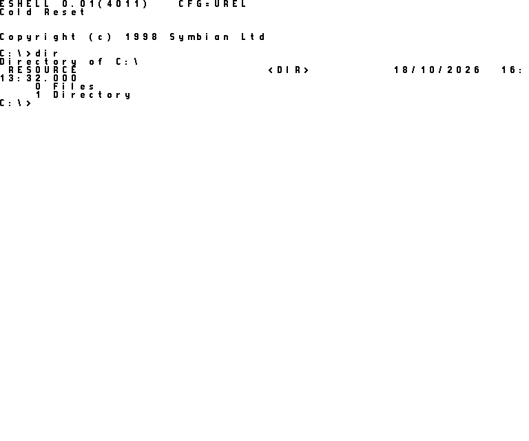

# symbian-2010

This is the 2010 Symbian open-source release, built from its own source with a modern compiler and booted in the
Symbian QEMU. Nothing in the Symbian source is edited. It runs the release's own kernel, file server and window server,
in the stripped-down **minigui** setup Symbian used to bring up new hardware.



That's all you get, though: a text shell in a window, with a working keyboard and a C: drive. There's no S60 home
screen, no apps and no touch interface. The display is the emulator's plain 768x640 framebuffer, and booting to the
prompt takes 30 to 50 seconds, because QEMU 0.9.1 has no CPU acceleration.

If you want the full Symbian^3 interface on modern hardware, that's what [Phorepoc](https://github.com/Phorepoc) is
for. This repository is deliberately frozen. Its job is to keep the original release running as close as possible to
how it shipped.

## Quick start

You'll need Docker, git and about 4 GB of disk. It works on Linux, macOS and Windows, since the build always runs
inside the [Phorepoc toolchain image](https://github.com/Phorepoc/toolchain).

```sh
./fetch.sh      # download the source into src/
./build.sh      # build out/minigui.rom and out/c_drive.img
./boot.sh       # boot it, type `dir`, and save out/fb.png and out/serial.log
```

The first build takes a few minutes on a big machine, or up to 20 on a laptop. After that only what changed gets
rebuilt, and `FULL=1 ./build.sh` starts from scratch. Every step logs to `out/log/`.

`boot.sh` uses the emulator image from [qemu-syborg](https://github.com/Phorepoc/qemu-syborg), whose README also
explains how to run it by hand and watch it live. The CI does exactly these three steps on every push and keeps the
screenshot and the serial log.

## How it works

The source isn't stored here. `sources.lock` pins the 13 Symbian packages the build needs, and `fetch.sh` downloads
them from our mirrors.

The release was written for Nokia's ARM compiler, RVCT, and a build tool called `elf2e32` that doesn't exist for
modern compilers. So we compile with today's GCC 14, and our own scripts in `emitter/` turn each compiled ELF file into
a Symbian E32Image, using the import and export tables frozen in the release's `.def` files. `tools/rombuild.py` then
puts everything into a ROM. The Syborg bootstrap was written in RVCT assembler, and `tools/armasm2gas/` translates it
for the GNU assembler.

The source also assumes a case-insensitive file system, with includes like `<f32plugin.h>` that only exist as
`F32plugin.h`. Rather than rename anything, `tools/casefix.py` adds links for every spelling the source uses.

## What we had to add

We didn't edit any Symbian file, but a modern compiler and a board with no real hardware need a few things added next
to the source:

- **Compiler glue.** `toolchain/symbian_gcc_prefix.h` defines what the release's own compiler headers expected but GCC
  doesn't provide. Two small header overlays fix code that modern GCC treats differently. One is `TRAP`, which returns
  twice and has to be marked so, or locals get lost across a leave.
- **Compiler flags.** The release depends on how RVCT and old GCC behaved, so we turn off a few modern optimisations,
  such as `-fno-strict-aliasing` and `-fno-delete-null-pointer-checks`. Each one has its reason in `toolchain/symcc`
  and `emitter/build_mmp.py`.
- **Runtime pieces** in `toolchain/dll_rt/` and `toolchain/efile_exe/` start up DLLs and programs the way the old
  toolchain's runtime did.
- **Kernel glue** in `kernel/` starts the Syborg display, storage and input drivers, which a real ROM would load from
  files. It also works around one hand-written assembler routine that GCC miscompiles.
- **Two stand-ins.** The graphics resource and surface update libraries are replaced with empty versions, because the
  emulator has no GPU and no compositor. Tracing is turned off, since the trace compiler wasn't part of the release.

Everything else, including the window server and the screen driver, is built unmodified from its own `.mmp` file.

## Finding your way around

```
fetch.sh, sources.lock   the source, pinned
build.sh, boot.sh        build in the toolchain image, boot in QEMU
scripts/                 what runs inside the container
kernel/                  kernel build and link, the glue, the ROM recipe
emitter/                 the .mmp reader, the component list, ELF to E32Image
toolchain/               compiler driver, prefix header, overlays, runtime pieces
tools/                   ROM writer, header export, bootstrap translation, FAT image
```

## License

EPL-1.0, the license of the Symbian release. The downloaded source keeps its own license headers.
